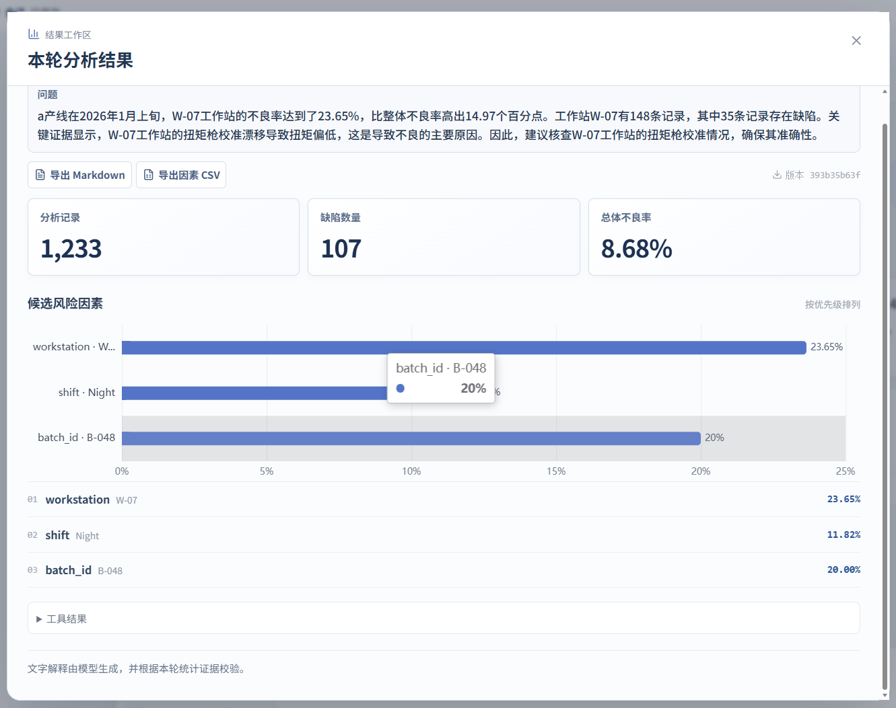
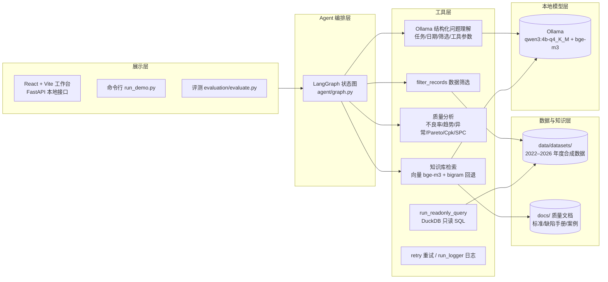
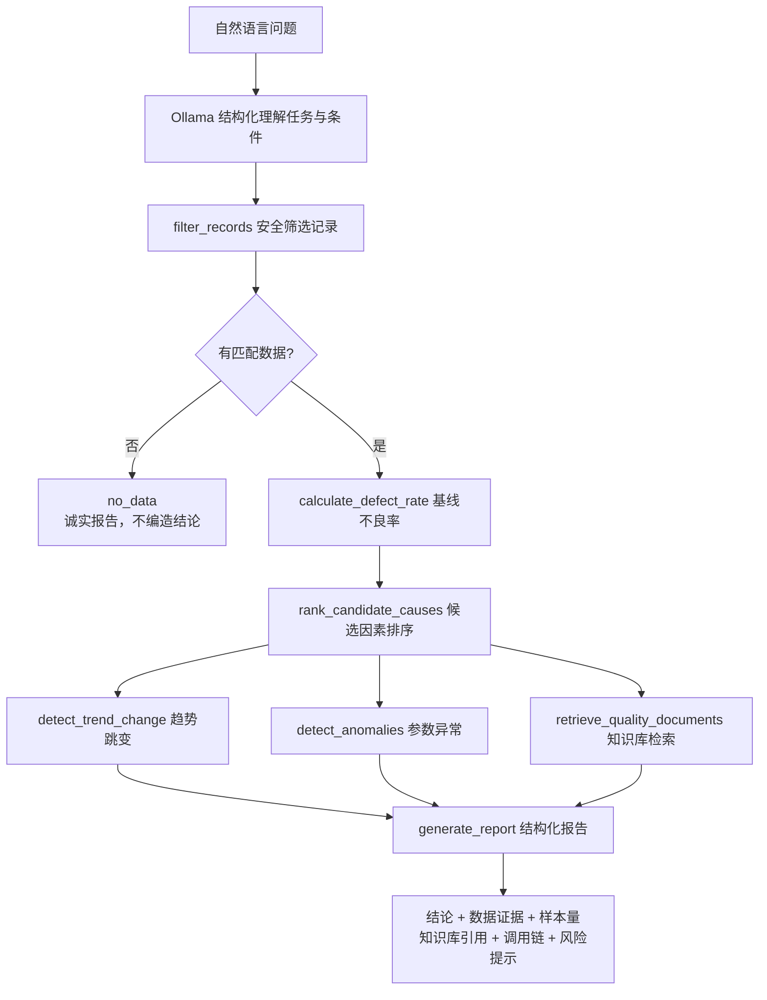

# Manufacturing Quality Root Cause Agent

面向新能源汽车制造场景的制造质量根因分析 Agent MVP。

GitHub 仓库：https://github.com/Satulalala/manufacturing-quality-agent

当前版本采用"Ollama 问题理解 + 确定性分析内核 + RAG 知识证据"架构：Ollama
负责理解任务、日期范围和分析参数；程序校验结构化结果后，再由确定性 Python
函数完成统计。LangGraph 编排工具，知识库采用 BM25 与向量混合检索。模型解析失败
或条件不明确时会要求重试/补充，不会回退规则解析并静默分析全量数据。
统计与筛选由确定性 Python 工具执行；本地问题解析默认不向云端发送数据。

## 工作台截图

<p align="center">
  
</p>

> 截图展示本地工作台的分析结果弹窗；其中使用合成演示数据。

## 功能一览

- **自然语言提问**：由本地 Ollama 统一理解任务、日期区间（含上旬/中旬/下旬）、
  车型、产线和工具参数；程序仅校验模型结果，不以关键词规则替代模型理解。
- **不良率分析**：计算指定范围的总不良率、缺陷数量、样本量。
- **候选因素排名**：按工位、班次、供应商、批次分组对比，排出最值得优先排查的
  前 3 个因素（带不良率、样本量、数据证据和人工确认建议）。
- **质量分析工具箱**：Pareto 缺陷类型分析（占比/累计占比）、Cpk 工艺能力
  指数（capable/marginal/not_capable 分级）、SPC 控制线检测（超限点定位）。
- **趋势跳变检测**：前后窗口对比，定位不良率突变发生的日期。
- **参数异常检测**：Isolation Forest 检出温度/压力/扭矩的离群记录（结果确定）。
- **知识库引用**：BM25＋本地 bge-m3 向量检索，用 RRF 融合排名；可进行规则重排
  或配置本地 CrossEncoder 模型。页面标明实际模式，向量不可用时降级 BM25。
- **按问题选择工具**：不良率分析、Cpk、SPC、参数异常、只读 SQL 与知识检索。
  Cpk 必须提供参数名和规格上下限；缺少必要输入时提示补充，不冒用演示规格。
- **基于证据解释**：可选 LangChain 模型根据工具结果与知识引用生成解释；
  检查引用与数字，模型失败或校验不通过时使用确定性解释。
- **可选 LangSmith**：记录运行过程；没有 API key 时不影响本地功能。
- **调用链追踪**：页面展示完整执行过程（解析 → 筛选 → 分析 → 知识库 → 报告），
  每次工具调用附记录，全流程可审计。
- **结构化运行日志**：每次分析写入 `logs/run_*.json`（问题、筛选条件、每步
  耗时、状态、不良率、候选因素、人工确认标记），可追溯可统计。
- **工具失败重试**：LLM 调用、SQL 执行自动重试（指数退避），网络抖动不降级。
- **人工确认标记**：统计候选结论带 `requires_human_review` 标记，页面提供
  "标记为已确认"按钮，符合"相关性不等于因果性"的工业约束。
- **解析条件回显**：页面显示本次问题解析出的查询条件（日期范围/产线/车型），
  发现解析不对可以立即看到。
- **知识库引用卡片**：命中时以卡片展示文档名、章节和原文摘要；未命中明确说明。
- **只读 SQL 工具**：DuckDB 查询，表/列白名单，恶意 SQL 被拒绝。
- **固定问题集评测**：22 道题自动评测，统计完成率、准确率和响应时间。

## 快速运行

要求：Python 3.10 或更高版本。

### 新版 Agent 工作台（推荐）

新版工作台采用独立 React 页面，分析仍由本地 Python Agent 执行。首次启动需要 Node.js；后续若前端已构建，只需要 Python 环境。

```powershell
python -m pip install -r requirements.txt
cd frontend
npm ci
npm run build
cd ..
```

构建完成后双击 `start_app.bat`。页面默认只监听本机 `127.0.0.1`，同一轮的统计、执行阶段和模型解释会按真实后端事件更新。上传 CSV 会保存在本机 `.cache/quality_workbench/sources`，会话复用现有 SQLite 检查点。

开发模式分别运行 API 和 Vite：

```powershell
.\.venv\Scripts\python.exe -m uvicorn server.main:app --host 127.0.0.1 --port 8000
cd frontend
npm run dev
```

开发页面地址为 `http://127.0.0.1:5173`；Vite 会把 `/api` 请求代理到本地 API。

### AI 扩展与真实本地模型

建议使用项目虚拟环境；`start_app.bat` 优先使用 `.venv` 中的 Python：

```powershell
python -m venv .venv
.\.venv\Scripts\python.exe -m pip install -r requirements-ai.txt

# 已安装 Ollama 后准备模型；本机已有模型时无需重复拉取。
ollama pull qwen3:4b-q4_K_M
ollama pull bge-m3
$env:QUALITY_LLM_MODEL = "qwen3:4b-q4_K_M"
$env:QUALITY_LLM_TIMEOUT = "60"
.\.venv\Scripts\python.exe run_demo.py "分析 2026-01-01 到 2026-01-31 A产线的不良率"
```

解析方式固定为本地 Ollama；环境变量 `QUALITY_AGENT_LANGCHAIN=false` 可关闭
LangChain 生成解释。`.env.example` 提供变量说明，程序不会自动读取 `.env`。
默认使用 `qwen3:4b-q4_K_M`（Ollama 官方量化包约 2.6 GB），优先兼顾本机推理速度和常见质量筛选解析。Ollama 默认等待上限为 60 秒，可通过 `QUALITY_LLM_TIMEOUT` 在 1–120 秒范围内调整；更换模型前先执行对应的 `ollama pull`，并设置 `QUALITY_LLM_MODEL`。

可直接输入的工具问题：

- `计算 2026-01-01 到 2026-01-31 A产线的扭矩 Cpk，USL=50，LSL=40`
- `分析 A产线的压力 SPC 控制线`
- `检测 A产线温度、压力、扭矩的异常记录`
- `查询 2026-01-01 到 2026-01-03 A产线的数据`
- `查扭矩偏低维修案例`

只读 SQL 任务使用当前 CSV 和受控查询参数，不执行模型生成的任意 SQL。
日期支持明确年份的中文日期，例如“2026年一月十五号之前”筛选至 `2026-01-14`，“之后”从 `2026-01-16` 开始；无法识别的相对日期及无年份的中文日期（Ollama 模式）要求补充，避免意外分析全部数据。
多个任务同时出现时当前只执行路由选中的一个任务，尚未实现自由循环规划。

### 检索对照评测与重排

```powershell
.\.venv\Scripts\python.exe -m evaluation.retrieval_benchmark --top-k 3 --json evaluation/retrieval_report.json
```

同一语料和题集比较关键词、BM25、纯向量、混合、混合＋重排的 Recall@K、MRR
和查询耗时。向量不可用时相关方案标为 `skipped`，不会用 BM25 结果冒充向量结果。
默认重排是词语匹配规则，报告中明确标记 `lexical`，不称为神经重排。

如有本地 CrossEncoder 模型目录，可选择真实模型重排：

```powershell
.\.venv\Scripts\python.exe -m pip install sentence-transformers
$env:RAG_RERANKER_MODEL = "D:\Models\你的重排模型目录"
.\.venv\Scripts\python.exe -m evaluation.retrieval_benchmark --rerank-mode cross_encoder --reranker-model $env:RAG_RERANKER_MODEL
```

模型只能从已配置的本地目录加载。未安装或未配置时明确记录原因。

### LangSmith 追踪

默认关闭，准备自己的 API key 并确认允许上传本次追踪数据后，在启动程序的同一终端配置：

```powershell
$env:QUALITY_LANGSMITH_TRACING = "true"
$env:LANGSMITH_API_KEY = "你的 API key"
$env:LANGSMITH_PROJECT = "manufacturing-quality-agent"
.\.venv\Scripts\python.exe run_demo.py
```

本地 JSON 日志继续保留。关闭远程追踪不影响模型调用，两条数据路径分别控制。
追踪便于查看问题，评测正确性仍由人工标注题集和业务判断标准决定。

新增知识点见 `docs/进阶学习补充.md`；同样的章节追加到桌面学习路线的末尾。
已有学习路线内容按字节保留，原文备份放在 `.cache/task-baseline/`。

### 命令行版本

```powershell
python run_demo.py
```

也可以输入自己的问题：

```powershell
python run_demo.py "请分析 2026-01-01 到 2026-01-15 B产线的不良率异常"
```

工作台默认加载 `data/datasets/quality_records_2026.csv`，并提供 2022–2025 年度数据源供选择和多文件对比。五份数据均为可复现的合成记录，不代表任何真实企业生产数据；字段口径和限制见 [数据字典](data/datasets/README.md)。

### 评测

```powershell
# 评测问题会通过本地 Ollama 解析
python evaluation/evaluate.py
```

### 配置本地 Ollama 问题解析

```powershell
# 问题解析固定使用本地 Ollama；需先安装 Ollama 并拉取模型
ollama pull qwen3:4b-q4_K_M
```

Ollama 不可用或无法理解问题时，页面会停止分析并提示检查/补充条件；质量统计仍由确定性工具计算。

## 运行测试

项目使用 Python 标准库 `unittest`：

```powershell
python -m unittest discover -s tests -v
```

> 部分用例（向量检索）调用本地 Ollama，全量约 6 分钟；不启动 Ollama 时
> 这些用例自动回退到关键词检索路径，测试仍可通过。

## 系统架构



## Agent 执行流程



## 旧数据集评测归档（2026-08-09，2400 条）

以下指标来自已删除的旧版 `data/demo_records.csv`，仅作历史记录，不代表当前 `data/datasets/` 的表现。

| 指标 | 结果 |
|---|---|
| 任务完成率 | 22/22 = 100% |
| 数值准确率 | 14/14 = 100% |
| 候选因素命中率 | 100% |
| 引用准确率 | 100% |
| SQL 成功率 | 6 条检查（3 合法 + 3 恶意）= 100% |
| 人工审核通过率 | 20/20 = 100% |
| 平均响应时间 | 约 3.2 s（含向量检索） |
| 状态分布 | success 20，no_data 2 |

qwen2.5:7b（Ollama 本地）解析后端下，完成率与数值准确率同样为 100%，
平均响应时间约 7 s。

## 成功与失败案例

详见 [docs/cases.md](docs/cases.md)。摘要：

**历史示例说明**
旧版单月演示数据的具体命中率和趋势数值不适用于当前多年度数据集。当前数据集的所有质量模式均为合成场景；正式结论需针对所选数据源重新分析，不能将模拟相关性解释为真实因果。

**已修复的失败案例（LLM 解析后端）**
1. 车型问题：`ID.4 车型` 现在能正确解析为 `vehicle_model=ID.4`。
2. 中文日期：`1月1日到1月15日` 现在能正确转换为 `2026-01-01 ~ 2026-01-15`。
3. 复合产线：`A产线和B产线` 现在解析为 `["A", "B"]`，两条产线都参与统计。

## 代码结构

```text
analytics/quality_analysis.py  纯 Python 质量分析函数
analytics/trend_analysis.py    不良率趋势跳变检测（前后窗口对比）
analytics/anomaly_detection.py Isolation Forest 工艺参数异常检测
analytics/pareto.py            缺陷类型 Pareto 分析（占比/累计占比）
analytics/process_capability.py Cp/Cpk 工艺能力指数
analytics/spc_analysis.py      SPC 控制线与超限点检测
data/datasets/                 2022–2026 年标准化合成质量数据
data/generate_quality_datasets.py  可复现年度数据生成脚本
data/demo_data.py              小型兼容测试样本和 CSV 读取函数
docs/                          质量知识库（标准/缺陷手册/维修案例）与项目文档
rag/ingest.py                  知识文档切分与索引（显式文件名白名单）
rag/retriever.py               字符 bigram 确定性检索（回退用）
rag/embedding.py               本地 Ollama embedding 客户端（bge-m3）
rag/vector_retriever.py        语义向量检索（余弦相似度）+ 向量索引
tools/quality_tools.py         Agent 可调用的数据筛选工具
tools/sql_tool.py              DuckDB 只读 SQL 查询工具（表/列白名单）
tools/anomaly_tool.py          趋势/异常检测的 Agent 调用包装层
tools/capability_tool.py       Pareto/Cpk/SPC 的 Agent 调用包装层
tools/knowledge_tool.py        知识库检索工具（无命中时明确说明）
agent/workflow.py              Agent 公共入口和报告渲染（兼容层）
agent/graph.py                 LangGraph 节点图（parse→query→analyze→knowledge→report）
agent/state.py                 LangGraph 状态定义
agent/llm_parser.py            Ollama 结构化问题理解与模型输出校验
agent/run_logger.py            结构化运行日志（logs/run_*.json）
tools/retry.py                 工具调用重试（指数退避）
frontend/                      React + TypeScript 工作台
server/                        FastAPI 接口与本地运行服务
start_app.bat                  新版工作台启动入口
run_demo.py                    命令行入口
evaluation/cases.json          固定问题集（22 题）
evaluation/evaluate.py         评测：任务完成率/数值准确率/响应时间
tests/                         Agent、分析和数据服务测试
tasks/plan.md                  切片二至十的开发规格与验收记录
```

## 简历项目描述

> 面向新能源汽车制造质量场景，基于 LangGraph 设计制造质量根因分析 Agent，
> 集成 DuckDB 只读 SQL 查询、异常检测、Pareto/Cpk/SPC 质量分析工具、语义
> 向量检索知识库（本地 bge-m3，支持同义表达召回）和结构化报告生成；问题
> 解析使用本地 Ollama qwen2.5:7b（工业数据不出厂），失败时停止分析并提示重试或
> 补充条件；含工具失败重试、人工审核标记与结构化调用日志；通过 22
> 题固定问题集八项指标评估（任务完成率/数值准确率/因素命中率/引用准确率/
> SQL 成功率/审核通过率/响应时间）全部 100%。

## 下一步扩展

1. 支持 Function Calling 与对话记忆，让 LLM 直接驱动工具调用。
2. 使用 DuckDB/PostgreSQL 替代直接加载 CSV 到内存。
3. 用 AI4I 等真实数据集替换模拟数据，做进阶演示。
4. 增加 Docker 部署和可观测性（调用链、耗时、成本统计）。
5. 评测补全引用准确率、SQL 成功率、人工审核通过率指标。

## 重要限制

候选因素是基于分组统计差异的优先级排序，不等于已证明的因果关系。进入真实
生产环境前，需要接入经过授权的数据、权限控制、人工审核和更严格的工业安全
流程。当前问题解析仅支持有限的日期格式和产线词汇，详见 docs/cases.md。
