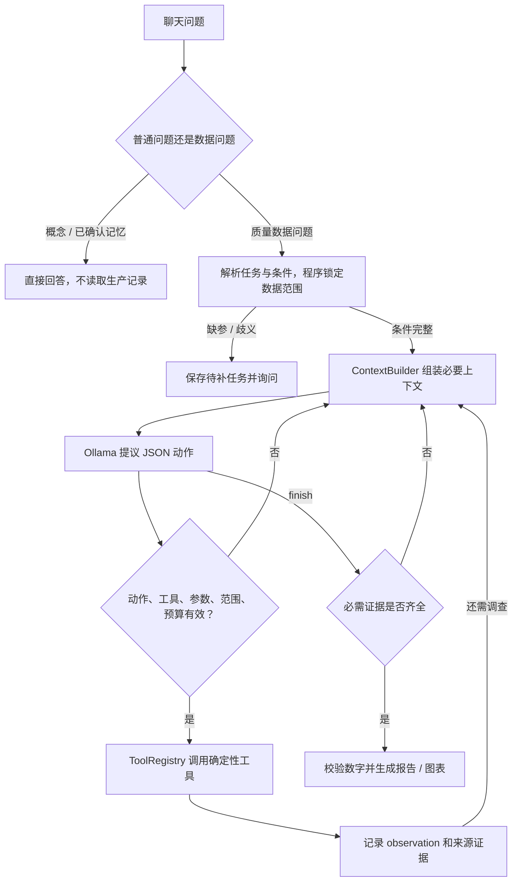

### 阶段八：混合检索与重排（第 13-14 周）

> **先上网学概念的关键词**：BM25、中文分词、字符二元组、稀疏检索与稠密检索、RRF 倒数排名融合、Reranker 重排、CrossEncoder、Recall@K、MRR
>
> **本次追加说明（2026-10-07）**：以下章节接在原有阶段七之后。前文保留了项目以前的实现，当前检索、模型解释和任务路由以新增章节及实际代码为准。项目位置为 `D:\Project\Intern`。

- **目标**：让知识库同时利用关键词和语义，并用同一批题目验证结果。
- **学什么**：BM25 找准确词语，向量检索找相近意思；两路结果融合后，再对少量候选结果重排。
- **在项目里做什么**：阅读 `rag/` 的混合检索实现和 `tools/knowledge_tool.py`，观察检索结果的来源、模式与降级原因。
- **练习**：
  1. 分别用“扭矩偏低”和“螺丝拧不紧”检索，查看两路排序差异。
  2. 用文档中确实存在的设备编号提问，检查关键词是否被保留为一个完整词。
  3. 关闭 Ollama 后再查一次，确认返回明确的 BM25 降级信息。
  4. 跑检索对照评测，对比命中率和耗时；不要把跳过的方案当成零分。
- **完成标准**：能解释“回退”和“混合”的区别；能用评测结果说明某个方案是否改善。

#### 阶段八自主搜索清单（每个知识点：先搜关键词，再对照项目文件，最后做验证）

**1. BM25——怎样找到准确词语**

- 搜索：`BM25 词频 逆文档频率 文档长度`、`中文 BM25 分词`
- 项目文件：`rag/retriever.py` 的 `tokenize()` 和 `retrieve_bm25()`。
- 验证：查询“扭矩偏低”，观察含这些词的文档是否排在前面；再输入完全无关的词，检查是否返回空结果。
- 大白话：像翻目录查关键词。一个词在所有文档都出现时，区分能力小；只在少数相关文档出现时，区分能力大。

**2. 混合检索——两条路都走一遍**

- 搜索：`hybrid search BM25 embedding`、`稀疏检索 稠密检索`
- 项目文件：`tools/knowledge_tool.py` 与混合检索模块。
- 验证：查看同一条结果的 `sources` 和 `source_scores`，确认它来自 BM25、向量，还是两路共同命中。
- 对照：原来的“向量失败才查关键词”是回退；现在的“BM25 和向量分别查，再合并”是混合。

**3. RRF——不同分数怎么合并**

- 搜索：`Reciprocal Rank Fusion RRF 公式`
- 项目文件：`rag/hybrid_retriever.py` 的 `fuse_ranked_results()`。
- 验证：假设常数是 60，一篇文档在 BM25 排第 1、向量排第 3，融合分数就是 `1/61 + 1/63 ≈ 0.0323`；对照实际代码的常数。
- 大白话：两位评委各自排名，再按名次加分。BM25 分数和余弦相似度的量纲不同，不能随便直接相加。

**4. 重排——对候选结果再检查一次**

- 搜索：`RAG reranker cross encoder bi encoder 区别`
- 项目文件：`rag/hybrid_retriever.py` 的 `_apply_reranker()`。
- 验证：检查 `reranker_mode` 和 `reranker_is_neural`；用同一个问题比较重排前后前三条结果。
- 大白话：初检先选出候选资料，重排再把更相关的资料往前放。
- 注意：词语匹配重排是离线规则；CrossEncoder 是模型重排。两者应分别标注，不能把规则重排称为神经模型。

**5. 降级——模型服务不可用时怎么办**

- 搜索：`graceful degradation fallback 可观测性`
- 项目文件：`tools/knowledge_tool.py` 返回的 `metadata`。
- 验证：关闭 Ollama，检查 `vector_status`、`retrieval_mode` 和 `fallback_reason`；确认程序仍可查询。
- 注意：程序能继续运行，不表示原来的向量方案已经通过验证。

**6. Recall@K 与 MRR——用题目衡量检索**

- 搜索：`Recall@K 检索评估`、`MRR 平均倒数排名`
- 项目文件：`evaluation/retrieval_benchmark.py`。
- 验证：给同一套题标出应命中的文档和章节，再运行所有方案。
- 数字例子：某题有 2 条相关资料，前三条结果找到 1 条，`Recall@3 = 1/2`；第一条相关资料排第 2，倒数排名为 `1/2`，所有题取平均得到 MRR。
- 注意：题集很小的高分只说明这批题表现好；真实生产问题仍需要另外验证。

**阶段八通关标准**

- [ ] 能说清 BM25 和向量分别擅长什么。
- [ ] 能手算一个 RRF 分数。
- [ ] 能区分规则重排和模型重排。
- [ ] 能解释降级原因和 skipped 的含义。
- [ ] 能用同一题集对比检索质量与耗时。

---

### 阶段九：基于证据的模型解释（第 15-16 周）

> **先上网学概念的关键词**：RAG 证据引用、grounding、结构化输出、JSON 校验、提示词注入、事实白名单、确定性计算与 LLM 分工

- **目标**：让模型解释已有结果，并让关键结论能回到统计数据或文档原文。
- **学什么**：先计算、再检索、最后解释；校验模型输出；证据不足时说明不足；模型失败时保留确定性结果。
- **在项目里做什么**：跟着 `agent/graph.py` 和 `agent/workflow.py` 看统计结果、知识库引用怎样传给解释步骤。
- **练习**：
  1. 对照 Cpk 工具结果和报告中的数字，确认计算来自 Python。
  2. 查看一条解释的证据编号，找到对应统计结果或文档章节。
  3. 在测试中返回不存在的证据编号，确认被拒绝并回退。
  4. 模拟模型超时，确认工具计算结果仍保留。
- **完成标准**：能指出一句解释的证据来源；能解释为什么格式正确仍不等于事实正确。

#### 阶段九自主搜索清单（每个知识点：先搜关键词，再对照项目文件，最后做验证）

**1. 确定性计算——数字从哪里来**

- 搜索：`LLM 调用工具 计算可靠性`、`deterministic computation`
- 项目文件：`tools/capability_tool.py`、`analytics/process_capability.py`。
- 验证：用同一份数据运行两次，检查 Cpk 等数值相同；模型只负责解释这些结果。
- 数字例子：如果工具算出 `Cpk=0.54`，报告就应引用这个值，不能让模型凭印象改成 `1.54`。

**2. 证据组织——哪些内容允许进入解释**

- 搜索：`RAG evidence grounding citations`
- 项目文件：`agent/graph.py` 的 `_evidence_refs()` 和 `_explain()`。
- 验证：区分统计证据和知识文档证据；只有真实检索到的文档才可引用。
- 注意：维修案例提供排查线索；相似案例不能证明当前问题一定有相同原因。

**3. 结构化输出——让回复有固定形状**

- 搜索：`LangChain structured output JSON schema Pydantic`
- 项目文件：`agent/model_adapter.py` 的 `create_langchain_model_fn()` 和 `agent/graph.py` 的 `_explain()`。
- 验证：让测试模型返回缺字段、错误类型和非法 JSON，确认有明确回退。
- 大白话：像填表，字段先规定好，再检查每一格是否合格。

**4. 引用与数字校验——不能只信模型的话**

- 搜索：`RAG citation validation hallucination evaluation`
- 项目文件：`tests/test_agent_extensions.py` 与解释校验函数。
- 验证：返回不存在的引用或未提供的数值，检查是否被拒绝。
- 注意：引用存在并不自动证明整句话被支持；自动校验之外仍要对照原文和评测题。

**5. 不足与回退——不编造也能交付结果**

- 搜索：`LLM fallback evidence insufficient`
- 项目文件：`agent/workflow.py` 返回的解释模式和失败原因。
- 验证：断开模型服务，确认报告继续显示真实工具结果，并标注使用了确定性解释。

**阶段九通关标准**

- [ ] 能指出每个统计数字的计算函数。
- [ ] 能从解释回到证据来源。
- [ ] 能演示错误引用被拒绝。
- [ ] 能解释自动引用检查的能力边界。
- [ ] 能演示模型失败时报告仍可用。

---

### 阶段十：LangChain 工具选择与 LangGraph 分支（第 17 周）

> **先上网学概念的关键词**：LangChain 模型适配器、工具定义、Tool Calling、结构化意图路由、LangGraph 条件边、参数校验、只读 SQL、依赖注入

- **目标**：根据用户的问题选择对应工具，参数缺少时先补充，不把所有问题都走同一条分析链。
- **学什么**：问题意图、工具参数、受控执行、条件分支；区分规则路由、模型路由与自由循环 Agent。
- **在项目里做什么**：跟踪 `agent/graph.py` 的分支，查看报告里的任务、工具结果和缺少的输入。
- **练习**：
  1. 分别问“不良率”“扭矩 Cpk”“压力 SPC”“异常记录”“维修案例”，观察调用工具。
  2. 只问“计算 Cpk”，观察需要补充什么。
  3. 补充参数名和规格上下限，再运行一次。
  4. 问只读数据查询问题，检查执行的是受控 SQL 查询。
- **完成标准**：能画出“问题 → 路由 → 参数检查 → 对应工具 → 证据解释”的执行过程。

#### 阶段十自主搜索清单（每个知识点：先搜关键词，再对照项目文件，最后做验证）

**1. LangChain、LangGraph 各负责什么**

- 搜索：`LangChain LangGraph difference model tools workflow`
- 项目文件：`agent/model_adapter.py`、`agent/graph.py`、`requirements-ai.txt`。
- 验证：指出模型调用在哪里，分支在哪里，计算函数在哪里。
- 大白话：LangChain 连接模型与工具；LangGraph 安排流程并传递状态；统计工具完成具体计算。

**2. 路由——先判断要做哪种任务**

- 搜索：`LLM intent routing structured output`
- 项目文件：`agent/routing.py` 的 `route_task()` 和 `parse_task_inputs()`。
- 验证：问“计算 A产线的扭矩 Cpk，USL=50，LSL=40”，检查工具与参数；再问“查扭矩偏低维修案例”，检查是否转向知识检索。
- 注意：模型只能在允许的任务中选择；非法任务需要拒绝或回退。

**3. 缺少输入——为什么不能随便补默认值**

- 搜索：`agent clarification missing parameters`
- 项目文件：`agent/routing.py` 的 `parse_task_inputs()` 与 `tests/test_agent_extensions.py`。
- 验证：只问“计算 A产线的 Cpk”，确认报告明确索要参数名、规格上限和下限。
- 大白话：Cpk 要判断数据是否符合产品规格。没有规格就像没有靶心，不能判断打得准不准。
- 注意：工具箱中的演示规格仍可用于教学；自然语言任务不能把演示规格冒充用户实际规格。

**4. 条件边——固定顺序怎么变成分支**

- 搜索：`LangGraph add_conditional_edges StateGraph`
- 项目文件：`agent/graph.py` 的图构建函数。
- 验证：查看实际 `trace`，Cpk 问题应执行 Cpk 工具，SPC 问题应执行 SPC 工具。
- 注意：有分支的受控工作流不等于拥有任意规划、无限循环或自主执行权限。

**5. 只读 SQL——模型不能随意操作数据库**

- 搜索：`SQL 参数化查询 allowlist 只读权限`
- 项目文件：`tools/sql_tool.py` 与 Agent 的 SQL 调用位置。
- 验证：运行现有 SQL 安全测试，检查非法操作被拒绝；用户筛选值通过参数传递。

**6. 可选依赖——没装 AI 库也能运行什么**

- 搜索：`Python optional dependency import fallback venv`
- 项目文件：`requirements.txt`、`requirements-ai.txt`、`start_app.bat`。
- 验证：默认 `mock` 模式无需模型和 API key；真实 Ollama 模型路径需要 AI 依赖及本地模型。

**阶段十通关标准**

- [ ] 能区分规则路由和模型路由。
- [ ] 能指出 Cpk、SPC、SQL、异常、知识检索的入口。
- [ ] 能演示缺参后补充再运行。
- [ ] 能解释为何限制任务和 SQL 执行范围。
- [ ] 能解释受控工作流与自由循环 Agent 的区别。

---

### 阶段十一：LangSmith 追踪与对照实验（第 18 周）

> **先上网学概念的关键词**：LangSmith trace run span、traceable、自定义追踪、数据集评测、离线评测、实验对比、耗时、Token 用量、数据脱敏

- **目标**：看清一次分析每一步做了什么，并留下可以对照的实验记录。
- **学什么**：调用链与步骤记录；本地日志和远程追踪的区别；评测题、期望答案、指标和实际实验结果。
- **在项目里做什么**：查看 `agent/` 的追踪适配、`agent/run_logger.py` 和 `evaluation/retrieval_benchmark.py`。
- **练习**：
  1. 默认关闭 LangSmith，确认本地功能仍可运行。
  2. 有自己的 API key 后，选择允许上传的数据再启用追踪。
  3. 查看一次调用里路由、工具执行、检索和解释的关系。
  4. 比较两种检索方案，同步查看质量与耗时。
- **完成标准**：能说清一个失败发生在哪一步；能区分“通过离线测试”和“已连接远程平台实测”。

#### 阶段十一自主搜索清单（每个知识点：先搜关键词，再对照项目文件，最后做验证）

**1. Trace——一次分析的运行记录**

- 搜索：`LangSmith traceable custom instrumentation`
- 项目文件：`agent/` 的追踪实现。
- 验证：追踪中应能区分路由、工具与解释；没有远程凭据时不阻断正常分析。
- 大白话：像快递轨迹，显示每一步什么时候发生、拿到什么、在哪一步失败。

**2. 可选开启——不要把 key 写进代码**

- 搜索：`LangSmith tracing API key project environment variables`
- 项目文件：`.env.example` 和追踪配置读取位置。
- 验证：用 PowerShell 设置环境变量后，在同一终端启动程序；仓库没有真实密钥。

```powershell
# 在 D:\Project\Intern 中运行；先确认允许上传本次追踪数据。
$env:QUALITY_LANGSMITH_TRACING = "true"
$env:LANGSMITH_API_KEY = "你的 API key"
$env:LANGSMITH_PROJECT = "manufacturing-quality-agent"
.\.venv\Scripts\python.exe run_demo.py
```

- 注意：`.env.example` 是配置说明，不会自动加载；项目只在 `QUALITY_LANGSMITH_TRACING=true` 时才会上传追踪，关闭时设为 `false`。

**3. 本地日志与远程平台——记录放在哪里**

- 搜索：`LangSmith hide inputs outputs redaction`
- 项目文件：`agent/run_logger.py` 与追踪适配。
- 验证：检查本地 `logs/` 的记录，以及启用追踪后允许上传的输入输出。
- 注意：LangSmith 远程追踪和模型请求是两条数据路径；关闭远程追踪并不等于云端模型不接收提示词。

**4. 对照实验——统一题目才能比较**

- 搜索：`retrieval benchmark ground truth ablation study`
- 项目文件：`evaluation/retrieval_benchmark.py` 与生成的评测报告。
- 验证：所有方案使用同一语料、题集和 top_k；不可用方案记录 skipped，重排类型要准确标注。
- 注意：LangSmith 提供观察和评测工具；判断标准、期望文档与业务正确性仍需自己定义。

**5. 耗时与 Token——记录真实可得的信息**

- 搜索：`LLM token usage latency tracing`
- 项目文件：模型返回数据、追踪适配与检索评测报告。
- 验证：查看模型是否返回 Token 用量；没有返回时标为不可得，不能凭字符串长度伪造统计。

**阶段十一通关标准**

- [ ] 能解释 LangSmith 与 LangChain 的分工。
- [ ] 能在不启用追踪时正常运行项目。
- [ ] 能说明哪些数据进入本地日志、远程追踪和模型请求。
- [ ] 能区分离线测试、真实模型验证与远程平台验证。
- [ ] 能用实验记录说明效果、耗时和限制。

---

#### 新增阶段的推荐执行顺序

1. 先跑通默认模式和单元测试，查看实际工具调用。
2. 再跑检索对照评测，阅读各方案真实分数与状态。
3. 切换 Ollama，验证 LangChain 模型路由和证据解释。
4. 最后在具备凭据、确认可上传数据后启用 LangSmith。

#### 新增知识点的官方参考

- [LangChain 与 LangGraph 分工](https://docs.langchain.com/oss/python/langchain/overview)
- [ChatOllama 模型适配](https://docs.langchain.com/oss/python/integrations/chat/ollama)
- [LangSmith 自定义追踪](https://docs.langchain.com/langsmith/annotate-code)
- [LangSmith 评测](https://docs.langchain.com/langsmith/evaluation)

---

## 2026-10-30：从固定图切换到受控 Agent Loop

### 1. 先分清外层 workflow 和内层 loop

可以把一次质量调查想成工单流程：**workflow 是工单制度，loop 是调查员每一步选择下一种检查工具。**

- 外层 workflow 仍由 `agent/workflow.py`、FastAPI service 和 RunManager 负责：判断问题类型、确定本轮文件和筛选范围、处理缺参/取消、管理会话、保存结果并推送事件。
- 内层 Agent Loop 在 `agent/decision.py`：根据锁定的任务和已有工具观察，提出下一步动作；程序检查该动作是否允许，再调用确定性质量工具，把结果作为 observation 交回循环。
- 因而“只使用 Agent Loop”不表示删除 workflow。loop 不应自行决定请求归属哪个会话、能不能读取其它文件、是否把 `needs_input` 当成功，也不应负责 HTTP/SSE 生命周期。

### 2. 本项目当前的数据分析路径



模型只**提出**动作。白名单、参数、文件和范围均由 Python 校验；不良率、Cpk、SPC、Pareto 等数值由 Python 工具计算。当前 loop 使用受约束 JSON 动作，不要在面试中说成“模型可直接运行函数”或“已实现原生 provider tool calling”。

### 3. 三种 Agent 编排选择怎么比较

| 方案 | 谁控制下一步 | 优点 | 成本与适用场景 |
|---|---|---|---|
| 项目自写受控 Agent Loop | 模型提出动作，应用代码验证并执行；循环由项目掌控 | 工具白名单、范围约束、停止条件和业务证据可直接按质量场景定制；核心运行不需要 Agent 框架依赖 | Context、动作 schema、错误处理、预算、重试、日志、恢复和测试都要自己维护；适合边界严格、工具有限、希望展示应用工程控制力的项目 |
| LangChain `create_agent` | 框架提供常见的模型—工具循环和 middleware 扩展 | 快速组合模型、工具和常见 harness 行为，适合标准工具调用和快速迭代 | 业务范围与证据规则仍要自己写；抽象会隐藏部分执行细节。官方文档当前说明 LangChain Agent 建立在 LangGraph 原语之上，因此它是较高层入口，不是与 LangGraph 完全无关的另一套运行时 |
| LangGraph `StateGraph` | 开发者显式定义 state、节点、边和条件路由 | 流程可视、分支/重试/人工介入/持久化控制明确，适合业务步骤比较确定且需要图级运行控制 | 需要维护节点图和状态 schema；如果只是一个小型工具循环，显式图可能比任务本身更复杂 |

重要结论：它们不是“Agent Loop 新、LangGraph 旧”的简单排名。**Loop 是运行模式；workflow 是应用业务流程；LangChain `create_agent` 和 LangGraph 是可选的实现工具。** Agent 可以嵌入 workflow，workflow 也可以调用 agent。

官方资料：LangChain 将 Agent 定义为模型反复调用工具直到完成任务，并把 prompt、tools 和 middleware 作为 harness；文档说明需要更深控制时可以直接基于 LangGraph 构建。[LangChain Agents](https://docs.langchain.com/oss/python/langchain/agents) · [LangChain Learn：LangChain Agent 使用 LangGraph 原语](https://docs.langchain.com/oss/python/learn) · [LangGraph Overview](https://docs.langchain.com/oss/python/langgraph/overview) · [LangGraph Persistence](https://docs.langchain.com/oss/python/langgraph/persistence)

### 4. 这次代码改动具体意味着什么

1. 单文件、多文件比较和命令行的质量分析都进入同一受控 loop；普通知识问答和已确认记忆查询仍可走直接回答，不强行制造分析过程。
2. 前端不再显示“多步分析”开关；Loop 工具选择不是用户可切换的思考强度参数。
3. loop 使用有限工具目录、结构化 JSON 动作、参数/数据范围/预算校验、工具观察与必需证据检查。最终数值和图表仍由确定性代码生成。
4. 旧 LangGraph checkpoint 已导入应用自己的 SQLite JSON 状态表。核心 `requirements.txt` 不再安装 LangGraph；旧数据库迁移/回退时才需安装 `requirements-migrate.txt`。`agent/graph.py` 仍保留旧图构建函数作兼容/测试用途，但当前工作台分析主路径不调用它。
5. 这次改造没有证明小模型会更快或更准。模型可能需要多次决策；应按固定题集记录工具选择、筛选范围、统计断言、完成状态和耗时。

### 5. 面试时可以这样讲

> 我把质量分析的执行入口统一成一个受控 Agent Loop，但没有让模型直接操作数据。外层 FastAPI workflow 先锁定会话、数据文件和筛选范围；模型只能提出白名单 JSON 动作；Python 校验后执行确定性质量工具，再把结构化结果作为 observation 交给下一轮。与 LangChain `create_agent` 相比，我少依赖一层通用 harness，但要自己维护循环、上下文和边界；与 LangGraph 相比，我不再用 StateGraph 表达这条工具选择循环。固定步骤、人工审批或图级恢复需求增加时，LangGraph 仍可能更合适。当前真实 Ollama 固定问题集尚待验收，所以我不会声称模型完成率提升。

### 6. 本轮验证和学习练习

- `npm run build`：通过 TypeScript 和 Vite 生产构建；ECharts 结果图 chunk 超过 500 KB，构建有拆包提示。
- 定向回归：会话 JSON 状态不导入 LangGraph、checkpoint 回退导出、Cpk 缺参后续问/取消、错误提交回放等 7 项通过；此前 Agent Loop/统一工作流相关 22 项通过。
- 未完成：本轮没有用真实 Ollama 固定题集完成模型验收，也没有浏览器逐页验收或运行完整测试套件。历史 Ollama 超时记录仍是历史记录，不能当作当前模型测试结果。

学习顺序：先读 `agent/workflow.py` 里 `_invoke_controlled_loop`，再读 `agent/decision.py` 的动作解析/校验/停止条件，然后沿 `ToolRegistry` 找到 `tools/quality_tools.py`，最后检查对应测试。练习是用自己的话解释“模型提议动作—程序验证—工具执行—observation—证据门”的责任边界。

