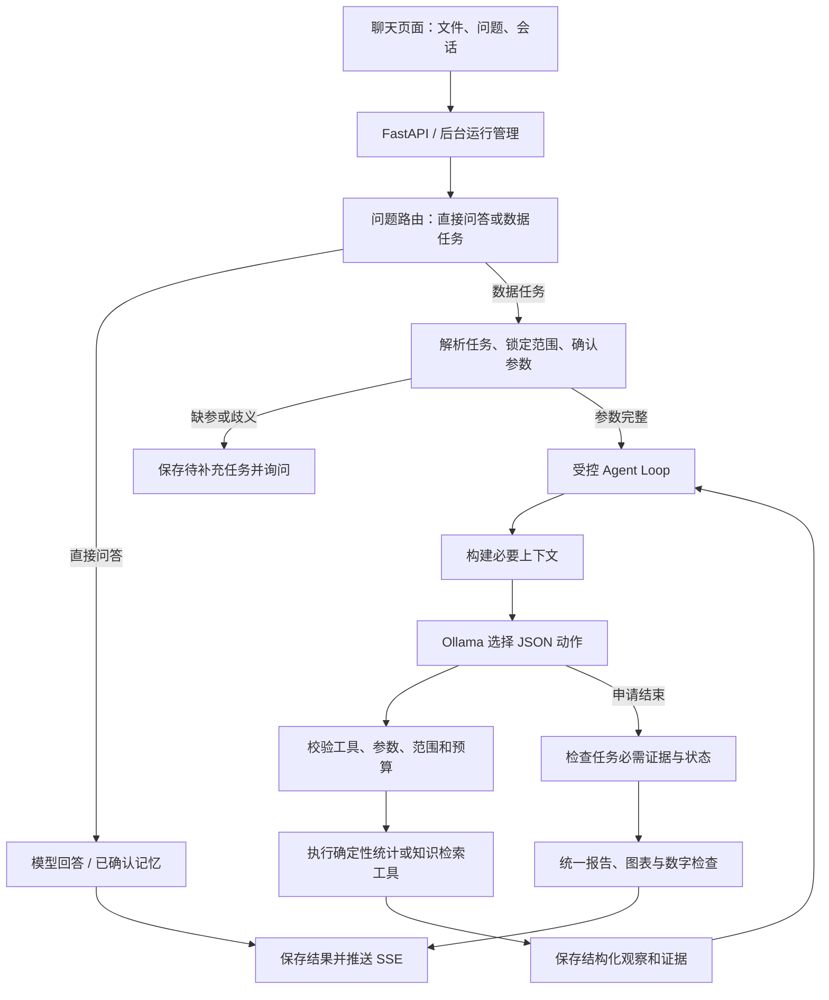

# 受控 Agent Loop 统一执行实施方案

> 制定日期：2026-10-30。实施状态：主路径迁移已完成；前端生产构建和针对性回归已通过。真实 Ollama 固定问题集尚未完成，不能据此声称模型质量或速度达标。原有历史计划保留在本文后半部分。本次沿用 Python、FastAPI、React、Ollama 与统计工具，没有新增第三方依赖或多 Agent。

## 1. 目标与完成标准

把当前“固定 LangGraph 分析图 + 可选自定义 loop”统一为“程序管理任务边界，单个受控 loop 选择分析工具”。用户只需提问，无需切换多步分析。普通问答/记忆问答直接回答；数据分析走 loop，简单统计允许一次工具调用后结束。

完成标准：所有已支持分析任务通过同一执行入口；筛选范围、必需证据、数字、状态由代码校验；单文件、多文件、追问、缺参补充、图表、会话、历史结果、取消和 SSE 均保持可用。若要完全移除 LangGraph，必须先迁移 session_store.py 的 checkpoint 状态，不能直接删依赖。迁移不以速度或准确率必然提升为承诺，必须做同条件实测。

## 2. 迁移前实现与必须处理的耦合（制定计划时基线）

> 下表保留 2026-10-30 方案制定前的源码基线，目的是解释为何不能只改一个开关；它不是迁移后的当前架构。完成状态见本文末尾“实施记录”。

| 当前代码 | 已有能力 | 迁移注意事项 |
|---|---|---|
| agent/decision.py | JSON 动作、工具白名单、范围校验、缓存、调用与时间预算、必需工具检查 | 作为核心复用；预算属于协作式检查，不是任意工具硬中断 |
| agent/workflow.py | 会话、规格记忆、缺参、两种执行分支、结果组装 | 简化成任务协调器；目前初始化仍 build_graph，不能只切开关 |
| agent/graph.py | parse_node、report_node、日期上下文、解释与证据检查，以及 StateGraph | loop 也调用其中函数；先抽公共能力再退役图 |
| agent/session_store.py | SQLite 会话索引 + LangGraph SqliteSaver 存储实际会话状态 | 去 LangGraph 必须导出并验证旧会话，禁止静默创建空会话顶替 |
| agent/context_manager.py、result_store.py、tools/registry.py | 上下文预算、证据存储、工具契约 | 复用；补足总体/下钻范围和多文件身份 |
| server/schemas.py、server/services/runs.py、comparisons.py | 请求开关、后台任务、运行事件、多文件子任务 | 单文件和比较任务必须同时迁移；数据库旧字段先保留兼容 |
| frontend/src/app/Workspace.tsx、api.ts | 多步分析开关、运行事件与历史显示 | 验收后取消开关；展示真实工具步骤及数据范围 |
| agent/model_adapter.py | 可选 LangChain Ollama 解释适配 | 与 loop 编排独立；本次保留，彻底移除 LangChain 属于另外的需求 |

注意：现有 loop 是模型返回受约束 JSON 动作，由程序执行；不是原生 tool_calls，也没有采用 LangChain create_agent。SQL 工具只有取得 csv_path 时才注册；不能把存在工具源码当成 Web 入口已经可用。

## 3. 目标架构

workflow.py 继续承担“打开哪份文件、继承哪些条件、保存什么结果”的外层协调。loop 承担“下一步选哪个工具”。工具负责真实计算。图表由确定性报告处理生成，模型不决定是否省略已有趋势图/Pareto 图。这里保留的是必要的程序流程，不再维护另一套固定分析图。

## 4. 核心执行约定

### 4.1 路由和解析

优先复用现有 direct_answer 与解析能力。普通问候、概念解释、明确记忆查询走直接回答；涉及数据事实的问题必须有数据证据。解析无法确定年份、月份组合、任务或文件范围时询问用户，不能靠措辞生成看似正确的结论。直接回答不展示数据分析阶段，也不产生伪造的统计卡片。

同一问题最多做一次必要的任务/条件解析；纯条件追问复用受校验的会话合并逻辑。解析属于任务准备，不要求模型自主决定是否执行。开始分析后本轮总体范围锁定，用户下一轮才可显式修改。

### 4.2 总体范围与调查范围分开

统一维护本轮 requested_scope、resolved_scope 和 data_scope；保留源文件集合、各自 data_version、选用的合并/比较模式。下钻工具另存 investigation_scope 和 parent_evidence_id。字段名称可适配既有结构，避免无意义公共 API 改名。

例如 B 线 7—8 月总体命中 315 条，下钻某工位只有几十条：主摘要仍为 315 条总体统计，下钻结果单独标记。不能继续从最后一个工具的 filters/baseline 直接替换总体。比较模式每个子任务拥有自己的总体和证据，合并模式证据身份包含全部文件及版本；合并不隐式去重，展示当前统计口径。

### 4.3 工具与结束规则

| 任务 | 完成所需的最低证据 | 补充能力 |
|---|---|---|
| 质量概览 | quality_summary 在本轮正确数据范围执行 | 需要时比较、下钻、检索 |
| 明确班次/工位对比 | compare_groups 对用户指定维度执行并具有样本统计 | 可补总体统计；不能只跑概览就宣布比较完成 |
| Cpk | 单位、测量字段及规格已确认，calculate_cpk 返回可用结果 | 缺参数询问，不使用猜测规格 |
| SPC / 异常检测 | 对应工具执行且满足样本/字段要求 | 样本不足应报告不足，不算成功分析 |
| 知识检索 | search_knowledge 返回可用证据，或明确说明未检索到 | 纯概念回答是否需要检索由路由策略确定 |
| 只读查询 | 入口提供有效数据访问能力且只读查询工具可用 | 入口不支持时明确说明，禁止模型改写成有结果 |

保留 call_tool / ask_user / finish 三类动作。finish 是结束申请，最终状态由程序判定。图表、数据覆盖范围和主摘要属于报告契约；用户明确要求“对比/趋势”等目标也必须纳入完成条件，不能只按 task 的粗类别判断。知识依据支持解释，不能把相关因素写成已证明的因果。

初期沿用现有预算：6 次工具调用、8 次决策；业务入口 loop 总预算 100 秒、决策单次默认超时 15 秒。解析和最终解释的耗时另外记录，不能把 loop 预算说成端到端硬时限。工具观察应区分 success、empty/no_data、needs_input、error、rejected 和样本不足，禁止因异常返回了一个字典就记作成功。不强制模型完成所有工具，不为“显得智能”固定跑满多轮。

## 5. 分阶段实施任务

### T01：建立行为基线与验收契约

涉及：tests/test_agent_loop.py、test_agent_workflow.py、test_requested_scope.py、test_comparisons.py、evaluation/ 中当前用例。

- 用同一数据版本列出单文件、合并、逐文件比较和各任务的现有输入/结果；记录报告、图表、事件结构。
- 选择独立可计算的数据断言；如当前 2026 CSV 的 B 线 7—8 月历史核对值为 315 条、12 条不良，实施时先检查文件是否变化再沿用。
- 验收：基线与已知问题分开，禁止将现存错误冻结为正确行为；测试结果仅记录实际执行项。

依赖：无。完成此步仍不切换入口。

### T02：抽出共用解析与报告能力

涉及：agent/graph.py、workflow.py、state.py；可新增小型解析/报告模块，名称实施时按现有边界确定。

- 将 loop 依赖的 parse_node、report_node、日期辅助和解释证据校验抽成普通函数；保留旧导入兼容转发。
- 保持固定图和 loop 仍可调用同一实现；避免本步同时改业务算法。
- 验收：解析、范围、数字检查、趋势与 Pareto 的针对性测试行为一致；loop 不必初始化 StateGraph 即可调用公共能力。

依赖：T01。

### T03：统一总体与下钻证据

涉及：agent/decision.py、result_store.py、workflow.py、context_manager.py、tools/registry.py。

- 补总体/调查范围、源文件集合版本和证据归属；修复“取最后一次 baseline/filter”可能覆盖总体的问题。
- 本轮缓存及历史证据复用校验工具、参数、数据源集合版本和完整范围；旧证据缺身份时不复用，历史页面仍可读。
- 验收：先概览再下钻时，主摘要不变；换文件、年份、产线或模式后不误用旧证据；工具无法越过锁定范围。

依赖：T02。检查点 A：公共能力与证据契约稳定后进入统一执行。

### T04：完善单个 loop 的任务完成规则

涉及：agent/decision.py、tools/registry.py、agent/context_manager.py、对应测试。

- 按用户目标确定必需证据，而不仅按质量分析大类检查；样本不足、工具失败、无数据有明确结果。
- 保留校验重试、缓存和预算；重复无进展动作应有明确停止原因，不能无限调用。
- 取消标记在决策/工具步骤之间检查，网络调用受超时限制；同步工具在执行中不能立即强杀的限制需准确展示。
- 验收：无必需证据不能成功结束；失败保留成功证据但标明未完成；缺参可保存 pending_task；所有路径均有终态。

依赖：T03。

### T05：接通全部入口并兼容旧请求

涉及：agent/workflow.py、server/schemas.py、server/main.py、server/services/runs.py、server/services/comparisons.py、run_demo.py。

- 数据分析默认统一走 loop，直接问答保留快路径；单文件、合并和逐文件比较采用同一任务执行器。
- 迁移期间使用仅开发配置可控的旧引擎回退开关，不再让前端逐请求决定引擎。use_decision_loop 旧字段暂接受但标记弃用，不允许旧客户端悄悄重启另一条执行路线。
- 子任务成功、缺参、失败、取消分别汇总；needs_input 不能计为完整成功。SSE 事件保持兼容，运行终态只落一次。
- 验收：Web、比较和命令行均通过目标路径；旧客户端不出现 422；缺参续问、取消、刷新重连和历史打开仍可用。

依赖：T04。

### T06：调整页面交互

涉及：frontend/src/app/Workspace.tsx、api.ts、相关类型/执行阶段组件。

- 删除多步分析开关；输入框和文件弹层维持现有功能；删除由该开关产生的页面状态与提交参数。
- 阶段列表按真实事件合并开始/结束条目，显示实际耗时和工具状态；不暴露模型内部思维过程。
- 总体数据摘要、下钻证据、结果弹窗及检索范围清楚区分；已取消任务晚到的响应不得覆盖新会话。
- 验收：桌面/窄屏输入框正常，直接问答无伪分析过程；趋势/Pareto 可见；失败/缺参不会显示“分析完成”。

依赖：T05。检查点 B：先完成端到端回归及真实模型评测，再让 loop 成为对外唯一执行路径。

### T07：迁移会话状态，解除 LangGraph 持久化依赖

涉及：agent/session_store.py、agent/conversation.py、现有会话测试与迁移脚本。此步为去除 LangGraph 的必需工作，并非简单删包。

- 将当前线程 checkpoint 中的 messages、reports、active_filters、active_query、pending_task、版本/身份等完整状态，转换为应用自有的 JSON 快照并使用现有 SQLite 保存。先确认字段、写入语义、容量和序列化规则。
- 在仍安装原依赖的环境中，先备份会话索引与 checkpoint 数据库，再通过当前 checkpoint 读取接口导出，写新存储并做会话数与逐字段校验。迁移可重复执行且不重复追加消息，校验失败保持旧库只读可恢复。
- 新读写链路暂保留可配置旧后端用于回退；禁止无提示丢弃旧状态、pickle 反序列化或覆盖旧库。迁移后产生的新消息要有回退导出方案，不能仅恢复旧备份造成增量数据丢失。
- 验收：重启前后历史消息、筛选、待补充任务和结果一致；缺文件/旧版本明确提示；进行中任务标记 interrupted，不宣称支持步骤级无损续跑。

依赖：T05；可在 T06 页面调整后执行，默认单 Agent 顺序推进。检查点 C：旧数据迁移和增量回退均通过才移除依赖。

### T08：退役旧图并整理依赖和文档

涉及：agent/graph.py、workflow.py、session_store.py、requirements.txt、旧图测试、README 和学习路线。

- 确认全部调用点已迁移后移除 build_graph、旧图专属路由和引擎开关；原图测试改测同等业务行为，不能通过删断言消除失败。
- 只有源码、测试及持久化均不再引用时才移除 langgraph/langgraph-checkpoint-sqlite。LangChain 解释适配和 LangSmith 可选追踪保持现有定位，避免扩大为提供商层重写。
- 旧数据库字段不急于删除，使用兼容读取；退役备份保留明确位置。更新 README 启动与架构、学习文档中的实现/计划边界及问题记录。
- 验收：安装声明与实际导入一致；无固定图运行依赖；所有迁移验收通过；说明单 loop 仍包含普通 Python 协调与持久化代码。

依赖：T06、T07及真实模型验收。

## 6. 验收矩阵与真实模型门槛

| 场景 | 必须观察到的结果 |
|---|---|
| 普通问答/已确认记忆 | 不触发 CSV 统计；需要范围限定的记忆不跨范围套用 |
| 简单质量概览 | 必需工具执行，数字可用独立计算核对；允许一次工具调用完成 |
| 7 月和 8 月、多年份、上/下半年 | 实际过滤与问题一致；歧义先问；无匹配不扩大范围 |
| 追问换产线/班次/清空日期 | 只继承应保留的条件，主摘要引用本轮证据 |
| 概览后下钻再结束 | 总体数与调查子集分别展示，不互相覆盖 |
| 合并/逐文件比较/增删文件 | 口径可解释，版本集合完整；比较缺参不算完整完成 |
| Cpk/SPC/异常 | 参数和样本不足有准确状态，不能用默认猜测规格 |
| 工具异常、坏 JSON、非法工具、越界参数 | 被拒绝或记录失败，重试有上限，不能伪装成功 |
| 超时、取消、重复提交 | 有清楚终态；记录局限；不重复覆盖报告 |
| 页面刷新与服务重启 | 可读已保存会话/结果；中途执行标记 interrupted；不虚构续跑 |
| 趋势/Pareto、导出与历史 | 新结果保留图表；历史缺数据准确提示，不回填伪造结果 |

先用注入决策函数验证确定性流程，再用当前实际 Ollama 模型跑固定问题集。至少覆盖概览、对比、下钻、检索、Cpk 缺参、连续追问和多文件，各自重复并保留每次动作轨迹。记录模型标签、提示版本、数据版本、配置、冷/热运行、端到端及解析/决策/工具/解释耗时、调用数、状态、范围/数字断言、工具错误和缓存命中。

上线门槛：确定性范围与数字断言必须全部通过；未知/越界动作不能执行；必需证据缺失不能标成功；会话迁移与增量回退必须通过；目标真实模型若反复无法完成核心任务，停止切换并保留旧入口。完成率、额外延迟和复杂调查收益按实测比较，不用未经测量的“更快更准”。

## 7. 风险、回退和实施边界

| 风险 | 处理 |
|---|---|
| 本地小模型工具选择不稳定、额外延迟 | 小型任务工具集、简洁 schema、一次统计即可完成、有限纠正；真实模型不达标就不切换 |
| 迁移时丢会话或重复消息 | 原库备份、完整导出校验、幂等导入、增量回退；先迁移后删依赖 |
| 下钻污染总体、跨文件证据串用 | 两类范围及证据身份明确，缓存包含文件集合与版本，回归直接断言 |
| 移除图后丢图表/报告能力 | 先抽公共报告，统一生成图表，逐任务验收，不以接口 200 代替业务通过 |
| 项目已有未提交修改较多 | 实施前记录当前差异，逐阶段最小修改，不回滚或覆盖他人已有内容 |

回退阶段一：入口迁移期保留服务端旧图开关，只在没有分析输出前对明确的引擎不可用问题切换并记录所用引擎；不在同一轮失败后静默混算两套结果。回退阶段二：会话存储迁移采用备份及增量导出恢复；旧依赖保留到切换通过。最终删旧代码后通过版本回退，不长期维护两套线上逻辑。

### 2026-10-30 实施记录

- **已完成：** 数据分析统一进入受控 Agent loop；普通问答与已确认记忆仍走直接回答路径。Web、比较和命令行不再由用户开关选择旧图；旧请求字段保留兼容但不能切换执行引擎。
- **已完成：** loop 复用解析、报告、工具注册和证据检查；前端移除“多步分析”开关。会话状态改为应用自有 SQLite JSON 快照，旧 checkpoint 做备份并幂等导入；新增旧格式回退导出命令并逐会话校验。
- **已完成：** 核心 `requirements.txt` 不再安装 LangGraph；旧 checkpoint 迁移/回退单独使用 `requirements-migrate.txt`。旧图构建函数仍留在 `agent/graph.py` 作为兼容/测试代码，当前工作台的分析入口不调用它；彻底删除该旧函数及专属测试留作清理项。
- **验证：** 前端 `npm run build` 通过；会话迁移/回退导出、无 LangGraph 的新会话读写、Cpk 补参/取消、错误提交回放等 7 个定向用例通过；Agent loop 和工作流相关 22 个用例通过。真实 Ollama 固定问题集、浏览器验收和完整测试套件未在本轮完成。
- **保留风险：** 小模型是否稳定选择工具、完成率和额外决策延迟尚无本轮实测。当前控制预算是代码保护，不代表运行时一定满足用户等待时间要求。

本轮没有增加自主代码执行、多 Agent、联网搜索、新模型部署或完整断点续跑。下一步应在固定模型、题集和数据版本下补真实 Ollama 验收；若结果不达标，应调整提示/任务拆分或恢复更确定的显式 workflow，而不是把模拟决策测试当成模型成功。

---

# 旧版 Agent 功能计划（历史记录）

> 本文记录旧版 Python Dashboard 时期的功能切片。Dashboard 已移除；当前 UI 架构与启动方式以 `tasks/frontend-redesign/plan.md` 和 README 为准。`run_demo.py` 命令行入口仍保留。

## 切片二：只读 SQL 查询工具（DuckDB）

## 目标

把"整份 CSV 读进内存再用 Python 筛选"升级为"DuckDB 只读 SQL 查询"，作为后续
LangGraph Agent 的标准数据工具。CSV 仍是数据源，DuckDB 直接查询 CSV，不建仓库。

## 范围

- 新增 `tools/sql_tool.py`：
  - `query_quality_data(csv_path, start_date, end_date, production_line, vehicle_model, columns, limit)`
    高层筛选查询，全参数绑定，输出结构化 dict。
  - `run_readonly_query(csv_path, sql, limit)` 底层只读 SQL 入口（供未来 LLM 工具调用）。
- 新增 `tests/test_sql_tool.py`。
- 更新 `README.md` 代码结构一节。

## 安全边界（对应 md 切片二验收）

- 仅允许单条 `SELECT`/`WITH` 语句；拒绝多语句。
- 黑名单关键字：INSERT/UPDATE/DELETE/DROP/ALTER/CREATE/ATTACH/COPY/PRAGMA/SET 等。
- 禁止任意文件读取函数（read_csv/read_parquet/glob/外部数据库 scan）。
- 表白名单：仅 `production_records`（内部视图，映射到指定 CSV）；FROM/JOIN 引用校验。
- 列白名单：`query_quality_data` 的 columns 参数仅允许 `FIELDNAMES` 中的列。
- 强制 LIMIT，默认 5000，上限 10000。

## 验收标准

1. 可按日期范围、产线、车型查询，结果与现有 `filter_records` 一致。
2. 恶意/写操作 SQL（DROP、DELETE、ATTACH、多语句、任意文件读取）被 ValueError 拒绝。
3. 输出为结构化 dict：status/row_count/records/filters/evidence。
4. `python -m unittest discover -s tests -v` 全绿。

## 不做

- 不接入 PostgreSQL，不改现有 `filter_records` 调用方，不做 LLM 生成 SQL。

---

# 切片三：异常分析工具

## 目标

补齐 md 阶段二要求的两个分析函数，作为 Agent 的"计算内核"：找到不良率
突变发生的日期，以及工艺参数（温度/压力/扭矩）的异常记录。纯确定性逻辑，
先于 LangGraph 完成，保证可独立测试验证。

## 范围

- 新增 `analytics/trend_analysis.py`：
  - `detect_trend_change(records, window=7, min_daily_samples=10)` — 按天聚合不良率，
    比较每个日期前后各 `window` 天窗口的均值差，返回变化最大的跳变点。
- 新增 `analytics/anomaly_detection.py`：
  - `detect_anomalies(records, numeric_fields, contamination=0.05, min_samples=50)` —
    Isolation Forest（`random_state=42` 保证确定性），标记离群记录。
- 新增 `tools/anomaly_tool.py`：Agent 调用层，包装两个函数并附排查建议（中文）。
- 新增 `tests/test_trend_analysis.py`、`tests/test_anomaly_detection.py`。
- 更新 `README.md` 代码结构。

## 输出契约

- `detect_trend_change`：`{status: change_detected|no_change, change_date, before_rate_percent,
  after_rate_percent, change_percent, window, daily_rates, evidence}`。
  样本不足或无跳变时 `status="no_change"`，不报假信号。
- `detect_anomalies`：`{status, sample_count, anomaly_count, anomaly_rate_percent,
  anomalies:[{record_id, timestamp, production_line, workstation, 字段值...}], evidence}`。
  样本 < min_samples 时 `status="insufficient_data"`。

## 验收标准

1. 构造"前低后高"60 天数据，跳变点落在高低分界日，数值可手工验证。
2. 无跳变/数据过少时不报假信号。
3. 注入明显离群点能被检出；同数据重复运行结果一致（确定性）。
4. 全量测试绿。

## 不做

- 不做因果推断、不做预测模型、不改 `app.py` 展示。

---

# 切片四：LangGraph Agent 工作流

## 目标

用 LangGraph 把"问题解析 → 数据查询 → 分析 → 报告"编排成有状态节点图，
工具调用顺序可追踪。保持 `QualityAgent.answer()` 的签名和报告契约不变，
`app.py`/`run_demo.py` 无需改动。

## 范围

- 新增 `agent/state.py`：`QualityState`（TypedDict）与初始状态。
- 新增 `agent/graph.py`：`build_graph()` — 节点 parse → query → analyze → report，
  no_data 条件边直接到 report；每个节点向 `trace` 追加调用记录。
- 重写 `agent/workflow.py`：`QualityAgent` 内部改为调用编译后的图，
  输出契约不变并追加 `trace` 字段；`parse_question`、`render_text_report` 保留。
- 新增 `tests/test_langgraph_workflow.py`。
- 更新 `README.md`。

## 验收标准（md 切片四）

1. 5 个预置问题（不同日期/产线/无数据）都能完成，无数据时走 no_data 分支。
2. `report["trace"]` 显示工具调用顺序：parse_question → filter/query → analyze → report。
3. 现有测试契约（status/question/filters/baseline/top_factors/summary）不变，全量绿。

## 不做

- 不接 LLM（`parse_question` 保持确定性，LLM 结构化输出留到后续）。
- 不改 `app.py` 展示层。

---

# 切片六：固定问题集评测

## 目标

建立固定问题集（≥20 个）和指标统计脚本，形成可复用的验收基线：
每次改动后跑同一套评测，对比指标。这是后续 RAG/LLM 改造的度量前提。

## 范围

- 新增 `evaluation/cases.json`：20 个固定问题，覆盖：
  - 不同时间范围（1-15/1-31/15-31/全线）
  - 产线 A/B、车型、工位提问
  - 无数据（2027 年）、无日期、无有效信息、英文提问
  - 部分 case 带数值断言（`expected_status`/`expected_line`/`expected_dimensions`）
- 新增 `evaluation/evaluate.py`：
  - `load_cases(path)` 读问题集
  - `run_case(agent, case)` 单题执行，返回状态、断言结果、耗时
  - `run_evaluation(agent, cases)` 汇总指标：任务完成率、数值准确率、
    平均响应时间、状态分布
  - `main()` 命令行入口
- 新增 `tests/test_evaluate.py`。
- 更新 `README.md`。

## 指标定义

- **任务完成率**：报告 status 与 `expected_status`（缺省为 success）一致的比例。
- **数值准确率**：有断言 case 中 `expected_line`/`expected_dimensions` 全部通过的比例。
- **平均响应时间**：全部 case 平均耗时（ms）。

## 不做

- 不做人工确认节点、失败重试、日志（md 切片六后半，留后续）。
- 不改 `app.py`。

---

# 切片五：质量知识库与引用

## 目标

给 Agent 建一个本地质量知识库（3 份 markdown 文档），回答时能检索并给出
文档引用；检索不到时明确说明，不编造来源（md 切片五验收）。

## 范围

- 新增 `docs/` 三份文档：`quality_standard.md`（质量标准）、
  `defect_code_manual.md`（缺陷代码手册）、`maintenance_cases.md`（维修案例）。
- 新增 `rag/ingest.py`：读取 docs/*.md，按 `##` 标题切分段落，生成 `rag/index.json`。
- 新增 `rag/retriever.py`：字符 bigram 打分检索（零新依赖、确定性），
  `retrieve(query, documents, top_k, min_score)`。
- 新增 `tools/knowledge_tool.py`：`retrieve_quality_documents(query, top_k)`
  Agent 工具，输出 `{status, query, results, evidence}`，无命中时
  `status="no_results"`。
- `agent/graph.py` 增加 knowledge 节点（analyze → knowledge → report），
  报告新增 `knowledge_refs` 与 `knowledge_summary`。
- `app.py` 在"分析依据"展开区展示知识库引用。
- 新增 `tests/test_rag.py`；更新 trace 顺序断言。

## 验收标准

1. "扭矩偏低"检索命中 `defect_code_manual.md`；"W-07" 命中维修案例。
2. 无关查询返回空并明确 `no_results`，不编造来源。
3. 同查询两次结果一致（确定性）。
4. 报告含 `knowledge_refs`（文档名/章节/摘要）与 `knowledge_summary`；全量测试绿。

## 不做

- 不用 embedding/向量库/LLM；不做文档新增后的增量更新。

---

# 切片七：可插拔 LLM 问题解析

## 目标

把规则版 `parse_question` 升级为"可插拔 LLM 解析后端"，解决 3 个已知失败
案例（车型、中文日期、复合产线），同时保证：无 key、连不上、答得不规范时
自动回退规则解析，评测基线不丢。

## 三种后端（环境变量 `QUALITY_LLM_PROVIDER`，默认 mock）

- `mock`：模拟器——本地规则解析（含中文日期、车型、复合产线），确定性，
  用于开发与测试。
- `ollama`：本地 Ollama（OpenAI 兼容端点 http://localhost:11434/v1，
  模型 `QUALITY_LLM_MODEL` 默认 qwen2.5:7b）。
- `glm`：智谱 GLM（OpenAI 兼容端点，密钥 `GLM_API_KEY`，
  模型默认 glm-4-flash）。

## 设计

- 新增 `agent/llm_parser.py`：
  - `make_parse_fn(provider)` 返回 `(question) -> filters` 的解析函数。
  - `parse_with_llm(question, provider)`：调用后端 → 校验清洗 → 与规则结果
    合并（LLM 漏掉的字段用规则补齐）→ 任何异常回退规则解析。
- `tools/quality_tools.filter_records` 的 `production_line` 支持
  `str | list[str]`，支持复合产线。
- `agent/graph.py` 的 `build_graph(parse_fn=parse_question)` 注入解析函数；
  `QualityAgent(records, llm_provider=None)` 默认 mock。

## 评测扩展

- `cases.json` 20 → 22 题：新增中文日期题、车型题。
- `run_case` 新增 `expected_start_date` / `expected_vehicle_model` 断言。

## 验收标准

1. mock 模式解析：`1月1日到1月15日`、`ID.4 车型`、`A产线和B产线` 全部正确。
2. LLM 输出坏 JSON / 类型错 / 网络失败 → 回退规则解析，结果可用。
3. LLM 漏字段 → 规则字段补齐（合并）。
4. 评测 22 题全绿；全量测试绿。

## 不做

- 不做对话记忆、不做 Function Calling 多轮，不接向量库。

---

# 切片八：失败重试、结构化日志与人工确认

## 目标

落地 md 阶段四"可控、可评估、可追溯"：工具调用失败自动重试、每次运行
输出结构化 JSON 日志、结论显式标记需人工确认。

## 范围

- 新增 `tools/retry.py`：`with_retry(func, attempts=3, backoff=0.2)`
  返回 `(result, attempts_used)`，指数退避重试，最后一次失败才抛出。
- `agent/llm_parser.py`：`_call_ollama`/`_call_glm` 包 `with_retry(attempts=2)`，
  网络抖动时重试，仍失败则回退规则（现有逻辑）。
- `tools/sql_tool.py`：`_execute` 包 `with_retry(attempts=2)`。
- 新增 `agent/run_logger.py`：`log_run(report, trace, provider, elapsed_ms)`
  写 `logs/run_<ts>_<id>.json`：时间戳、问题、后端、筛选、状态、不良率、
  候选因素、steps（含耗时）、requires_human_review。
- `agent/workflow.py`：`QualityAgent(records, llm_provider=None, log_dir=None)`
  `answer()` 计时并在运行结束时写日志（日志失败不影响主流程）。
- `agent/graph.py`：成功报告增加 `requires_human_review=True`（统计候选
  不等同因果，需人工确认）；no_data 为 False。
- `app.py`：证据区下方"标记为已确认"按钮 + 确认徽章。
- `.gitignore` 增加 `logs/`。
- 新增 `tests/test_retry.py`、`tests/test_run_logger.py`。

## 验收标准

1. `with_retry`：前 2 次失败第 3 次成功返回结果与 attempts_used；全失败抛错。
2. `QualityAgent.answer()` 后 `log_dir` 下生成合法 JSON，字段齐全。
3. 成功报告带 `requires_human_review=True`，no_data 为 False。
4. 全量测试绿，评测基线不丢。

## 不做

- 不做 LangGraph interrupt 真暂停节点（页面按钮 + 标记已够 MVP）。
- 不做日志轮转与审计查询界面。

---

# 切片九：RAG 向量检索升级

## 目标

把知识库从"关键词匹配（bigram）"升级为"语义向量检索"：问"螺丝拧不紧"
也能命中"扭矩偏低"案例。本地 Ollama embedding（nomic-embed-text），
数据不出厂；embedding 不可用时自动回退 bigram，评测基线不丢。

## 范围

- `ollama pull nomic-embed-text`（约 270MB，本地推理）。
- 新增 `rag/embedding.py`：`embed_texts(texts)` 调 Ollama `/api/embed`，
  `OllamaUnavailable` 异常。
- 新增 `rag/vector_retriever.py`：
  - `build_vector_index()`：文档切块 → 向量 → `rag/vector_index.json`
    （`{chunks: [...], vectors: [[...]]}`）。
  - `retrieve_vector(query, top_k=3, min_score=0.25, embed_fn=None)`：
    余弦相似度排序，输出与 bigram 同构（doc/section/score/snippet）。
- `tools/knowledge_tool.py`：向量优先，`OllamaUnavailable`/异常 → bigram 回退。
- 新增 `tests/test_vector_retriever.py`：确定性 fake embedder 测排序/过滤/
  top_k/回退；真实 Ollama 语义用例用 `skipUnless` 跳过。

## 验收标准

1. fake embedder：query 与目标块相似 → 该块第一；min_score 过滤生效。
2. Ollama 不可用时 knowledge_tool 回退 bigram，行为不变。
3. 真实 Ollama 下"螺丝拧不紧"命中扭矩相关章节（skipUnless 保护）。
4. 全量测试绿，22 题评测 100% 保持。

## 不做

- 不做向量库（FAISS/Chroma/pgvector），索引存 JSON 足够（30 块 × 768 维）。
- 不做增量更新与 embedding 缓存失效。

---

# 切片十：Pareto、Cpk、SPC 质量分析函数

## 目标

补齐 md 阶段二业务概念：缺陷类型 Pareto 分析、工艺能力指数 Cpk、
SPC 控制线检测。纯函数 + 测试 + Agent 工具包装，风格与现有 analytics 一致。

## 范围

- 新增 `analytics/pareto.py`：
  `pareto_analysis(records, defect_field="defect_type")` —— 缺陷类型按缺陷数
  降序，含占比与累计占比；无缺陷时 `status="no_defects"`。
- 新增 `analytics/process_capability.py`：
  `calculate_cpk(values, usl, lsl, min_samples=5)` —— 样本均值/标准差、
  Cp、Cpk（min(Cpu, Cpl)）；分级：>=1.33 capable / >=1.0 marginal /
  <1.0 not_capable；std=0 时 `status="constant"`；样本不足 `insufficient`。
- 新增 `analytics/spc_analysis.py`：
  `spc_control_limits(values, min_samples=10)` —— 均值 ± 3 样本标准差控制线，
  检出超限点（含上/下侧）；样本不足 `insufficient`。
- 新增 `tools/capability_tool.py`：包装三个函数并附中文排查建议。
- 新增三个测试文件；更新 README。

## 验收标准

1. Pareto：排序、占比、累计占比正确；无缺陷时诚实报告。
2. Cpk：对称/非对称规格值可手工验证；四档状态（capable/marginal/
   not_capable/insufficient/constant）覆盖。
3. SPC：正常序列无超限；注入离群点被检出（含上下侧）。
4. 全量测试绿。

## 不做

- 不做控制图页面渲染（后续可选）、不做 p/np/u 图、不做 EWMA/CUSUM 图。

---

# 切片十一：评测指标补全

## 目标

把 md 第 9 节指标全部落地：在完成率/数值准确率/响应时间之外，新增
候选因素命中率、引用准确率、SQL 成功率、人工审核通过率。

## 指标定义

- **候选因素命中率**：有 `expected_dimensions` 的 case 中，预期维度出现在
  top_factors 的比例。
- **引用准确率**：`knowledge_refs` 中 (doc, section) 真实存在于知识库文档的
  比例；无引用不贡献分母。
- **SQL 成功率**：固定 3 条合法 SELECT 全部成功 + 3 条恶意 SQL 全部被拒
  （ValueError）的比例；无数据文件时标记 skipped。
- **人工审核通过率**：`requires_human_review=True` 且 top_factors 非空的
  case 占需审核 case 的比例（模拟审核规则）。

## 范围

- `evaluation/evaluate.py`：`run_evaluation(agent, cases, sql_csv=None,
  documents=None)` 新增四个指标；`main()` 打印全部指标；固定
  `VALID_SQL`/`MALICIOUS_SQL`。
- `tests/test_evaluate.py`：断言新指标存在与合理值。

## 验收标准

1. demo 数据上：引用准确率 100%、SQL 成功率 100%、因素命中率 100%、
   审核通过率 100%。
2. sql_csv=None 时 SQL 指标为 skipped，不抛错。
3. 全量测试绿。

## 不做

- 不做 Token 成本统计（本地模型不产生 token 费用）、不做人工实际点击
  审核的集成（页面状态不进入评测）。

